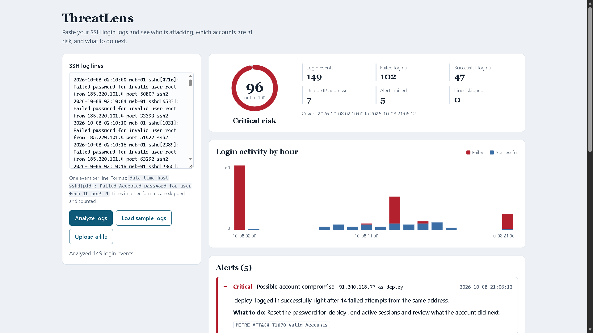
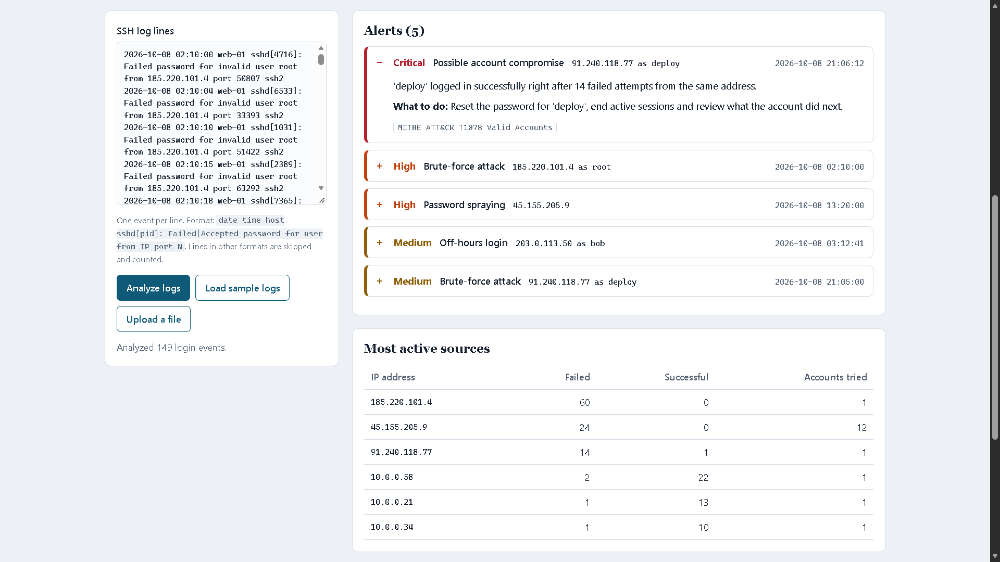

# ThreatLens

A mini SOC tool. Paste or upload SSH login logs and ThreatLens finds who is attacking, which accounts are at risk, and what to do next. Python standard library only, so there is nothing to install.

## Run it

1. Install Python 3.8 or newer.
2. Open this folder in VS Code, then open the terminal (Ctrl+`).
3. Start the server:
   - Windows: `py app.py`
   - Mac/Linux: `python3 app.py`
4. Open http://127.0.0.1:8000 in your browser.
5. Select **Load sample logs** to see the demo.

Use a different port with `py app.py 9000`.

## Run the tests

    py -m unittest -v

(`python3 -m unittest -v` on Mac/Linux.) All 27 tests should pass.

## What it detects

| Alert | Rule | MITRE ATT&CK |
|---|---|---|
| Brute-force attack | 5+ failed logins against one account within 5 minutes from one IP | T1110.001 |
| Password spraying | Failed logins against 4+ different accounts from one IP | T1110.003 |
| Possible account compromise | A successful login right after 3+ failures from the same IP (within 1 hour) | T1078 |
| Off-hours login | Successful login between 00:00 and 04:59 | T1078 |
| Root login | Any successful direct login as `root` (one alert per IP) | T1078 |

Risk score: critical alerts add 40 points, high 20, medium 8, capped at 100.

## Code quality

The code is formatted with Black and rated 10/10 by Pylint.

    py -m pip install black pylint
    py -m black .
    py -m pylint detector.py app.py test_threatlens.py

## Files

- `app.py` - web server and JSON API (`/api/analyze`, `/api/sample`)
- `detector.py` - log parser, one function per detection rule, risk score, sample log generator
- `static/index.html` - the dashboard (HTML, CSS and JavaScript in one file)
- `test_threatlens.py` - automated tests

## Log format

    2026-10-08 02:10:05 web-01 sshd[4121]: Failed password for invalid user root from 185.220.101.4 port 40022 ssh2
    2026-10-08 21:06:12 web-01 sshd[7733]: Accepted password for deploy from 91.240.118.77 port 51022 ssh2

Lines in other formats are skipped and counted on the dashboard.

## Two-minute demo script

1. "SOC analysts drown in raw logs. ThreatLens turns them into answers."
2. Select **Load sample logs**. Point at the risk score and the timeline spike at 02:00.
3. Open the critical alert: an attacker guessed the `deploy` password after 14 tries and got in.
4. Show the MITRE tag and the "What to do" line on each alert.
5. Show **Download report** and the recommended next steps.

## Ideas to extend it

- Add more log types (Windows event logs, web server logs)
- Add IP reputation or geolocation lookups
- Send alerts to email or Slack

## What I added and learned

- **Root login rule.** I added a new detection rule to `detector.py`: a successful direct login as `root` raises a high-severity alert (MITRE ATT&CK T1078), because root should rarely log in over SSH. I tested it in the dashboard, and the project's test suite covers it.
- **Threshold tuning.** I experimented with the brute-force threshold (5 vs 3 failed logins). A lower number catches attackers sooner, but it also flags people who just mistyped their password. Detection is always a trade-off between missed attacks and false alarms.
- **Code quality and security checks.** I ran Pylint, Black and Bandit, fixed what they found, and improved the Sentrix analysis score from B (82.5%) to A+ (99.4%).
- **Brute force vs password spraying.** Brute force hammers one account with many guesses. Password spraying tries a few passwords against many accounts, which avoids lockouts and is harder to spot. ThreatLens tells them apart by checking whether the failures hit one account or many.

Built with help from an AI assistant (Claude). I added the root login rule, tuned and tested it, and set up the project on GitHub.
